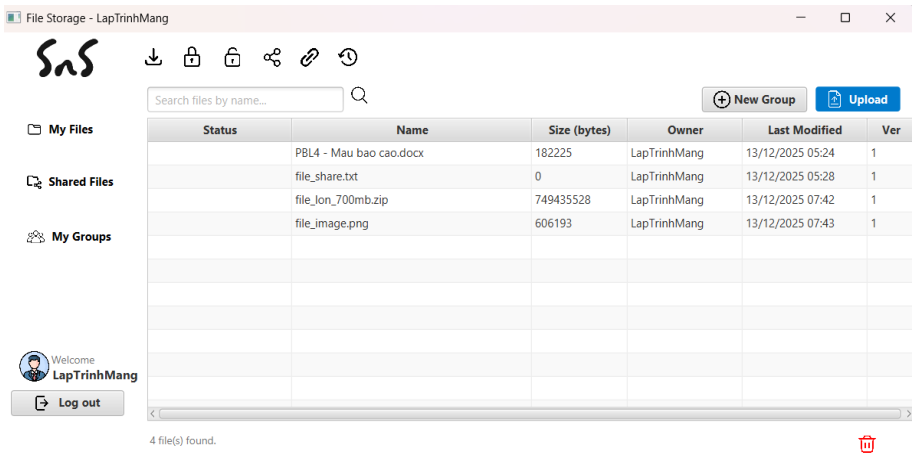
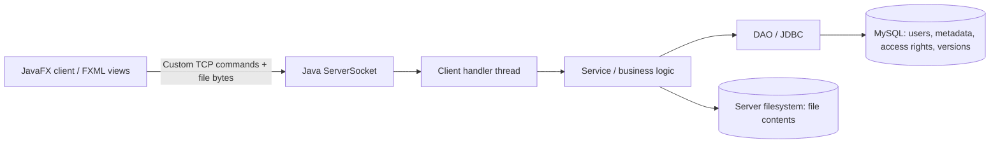

# File Storage & Sharing System

> Java client–server desktop application for file storage, controlled sharing, collaboration, and version history.

**Stack:** Java 21 · JavaFX 21 · TCP Sockets · Multithreading · JDBC · MySQL · Maven · FXML

## Overview

This PBL4 project implements a file-management system **without relying on a high-level web backend**. A JavaFX desktop client exchanges application commands and file bytes with a multithreaded Java server using a **custom text-based application protocol over TCP**. MySQL stores account and file metadata; actual file contents are stored in the server filesystem.

## Implemented features

| Area | Capabilities |
| --- | --- |
| Account management | Registration, login, logout, authorization checks |
| Personal files | Upload, download, list, delete |
| Direct sharing | Share files with another user; view received shares |
| Group collaboration | Create groups, manage members, share files in group workspaces |
| Public links | Token-based links with optional passwords and expiration/TTL |
| Version control | File version history and restoration of earlier versions |
| Concurrency | Pessimistic file locking to avoid conflicting modifications |
| Discovery | File-name search across personal, shared, and group contexts |

## Architecture

**Concurrency model:** One server thread per connected client. File-operation coordination uses pessimistic locking; it is not a distributed lock service.

## Main engineering decisions

- **Custom TCP protocol:** exposes the lower-level details of command parsing and file transport.
- **Separation of responsibilities:** JavaFX client, network handlers, services, DAO/data entities and physical file storage.
- **Metadata vs. binary content:** file metadata lives in MySQL while file bytes are stored on the server host.
- **File versioning:** maintain prior versions to support history and rollback.
- **Locking:** require a lock before conflicting modifications to reduce lost updates.

## Running locally

**Prerequisites:** JDK 21, Maven, MySQL (the report used MySQL 8.0.x), and a JavaFX-capable development environment.

1. Clone the repository and identify its server and client modules/projects.
2. Create a local MySQL database using the SQL/schema files provided by the repository, if present. Otherwise consult the project's schema documentation.
3. Configure database host, username, password, local file storage path, server address and TCP port for your machine. Do not commit local credentials.
4. Build the Maven modules and launch the **server first**, followed by the **JavaFX client**. Entry-point names and exact commands must be taken from the repository's current `pom.xml` / main classes.
5. Test registration/login, file upload/download, sharing, group operations and version restoration with two client sessions.

> Exact module names and commands are intentionally not invented here; confirm them against the repository source before publishing specific instructions.

## Verification and results

The academic report documents UI-based verification of registration/login, uploading and sharing, group management, locking/conflict handling, version history, shareable links and search.

## Known limitations

- **Thread-per-client** can consume significant resources as simultaneous connections grow.
- **Plain TCP** transport is not protected by TLS in the current academic implementation; do not deploy it across untrusted networks without transport security.
- Interrupted large transfers do not support resume.
- Deleting a group may leave its physical files orphaned.
- UI improvements, file previews, drag-and-drop and admin tooling remain possible enhancements.

## Academic context

PBL4 — Operating Systems & Computer Networks, Da Nang University of Science and Technology (DUT), December 2025. **Team project by Dang Hoang Huy and Nguyen Van Duong**; individual module ownership is not asserted in this README.
